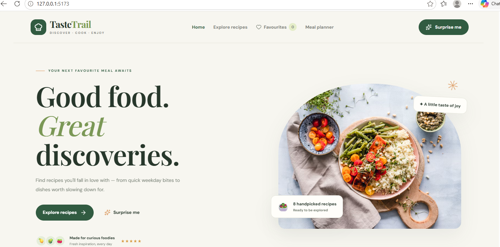
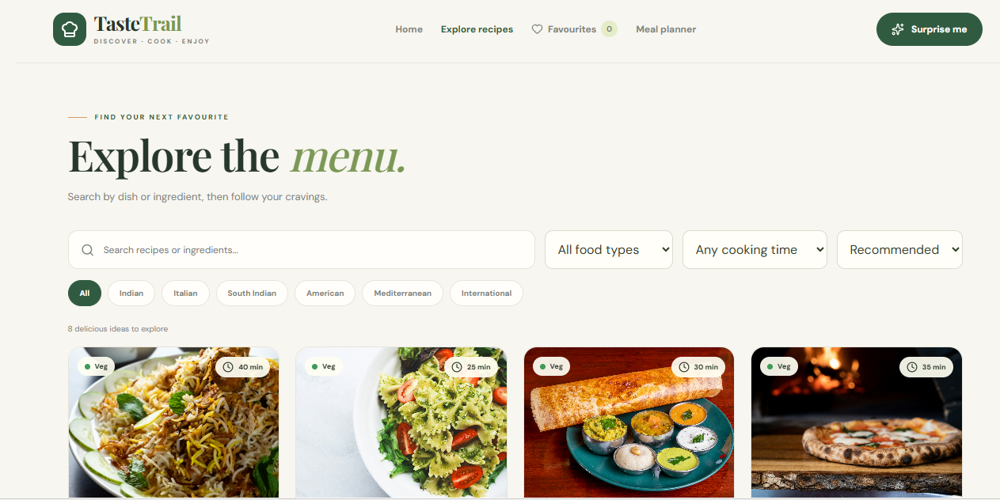
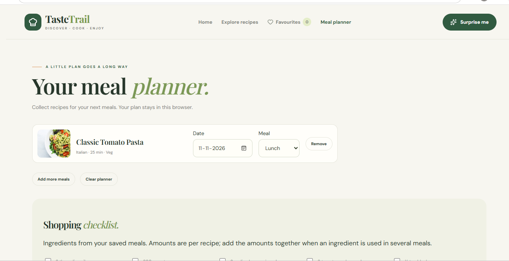

# TasteTrail — Recipe Discovery & Meal Planning

A React + Vite website with a Node.js API and persistent SQLite database. Preserves the original TasteTrail design and completes its discovery, favourites, cooking-guide, personal meal-planning, and user authentication flows.

## Start on Windows / VS Code

1. Extract the ZIP (do not run inside the compressed folder).
2. Open the extracted `tastetrail-frontend` folder in VS Code.
3. Use Node.js 22.12 or newer (Node 26 also works).
4. Open Terminal → New Terminal and run:

```powershell
npm ci
npm run dev
```

5. Open **http://localhost:5173**. One command starts both the frontend and recipe API.
6. Press Ctrl+C to stop both servers.

The frontend uses port 5173 and the backend uses port 5000. Stop any earlier copies of the project if either port is already occupied. Built-in `node:sqlite` database is automatically created, migrated and seeded on first run without requiring external database servers or native C++ compilers.

## Run the production build

```powershell
npm run build
npm start
```

Open **http://localhost:5000**. The server serves the built production website and API together.

## Database and Persistence

TasteTrail uses Node.js standard library `node:sqlite` with automatic migrations and seeding:
- **Zero native build dependencies**: Runs immediately on Windows without Python or Visual Studio C++ build tools.
- **Persistent storage**: Stored by default in `backend/data/tastetrail.db`.
- **Relational schema**: Includes users, recipes, ingredients, instructions, favourites, meal plans, shopping lists, pantry items, and reviews.
- **In-memory mode**: Configurable with `DATABASE_PATH=:memory:` for fast, isolated test suites.
- **Environment configuration**: See `.env.example` for environment variable options.

## Included features

- Home page, responsive navigation and animated recipe cards.
- User accounts and authentication with secure password hashing (`scrypt`) and session tokens.
- User registration, login, profile view, and logout modal.
- Persistent SQLite database with schema migrations and seed data.
- Eight curated recipes with quantities, cooking steps and actual difficulty labels.
- Search by dish or ingredient; cuisine and diet filters; maximum cooking time; alphabetical and quickest-first sorting.
- Egg-containing brownies correctly separated from vegetarian dishes.
- Recipe detail dialog with ingredient checkboxes and step-by-step cooking, keyboard focus trapping and Escape to close.
- Favourites saved in this browser, surviving refresh.
- Planner with recipe removal, dates, meal types and a clear action.
- Shopping checklist derived from planned meals, with checkmarks and text-file download.
- Surprise recipe selection.
- Loading, retry and API-unavailable states. A bundled copy of the recipe catalogue keeps discovery usable when the API is unavailable.
- Image fallback, storage-error handling and reduced-motion styling.

## Commands

| Command | Purpose |
| --- | --- |
| `npm run dev` | Start frontend and backend together |
| `npm run dev:frontend` | Start only Vite |
| `npm run dev:backend` | Start only the API |
| `npm run build` | Generate `dist` |
| `npm start` | Serve the API and built website on port 5000 |
| `npm run preview` | Preview the build on Vite's preview port, using the bundled recipe fallback |
| `npm test` | Run catalogue, filtering, storage, server, auth and database checks; build first |

## API

- `GET /api/health` — server status, database connection state and recipe count.
- `GET /api/recipes` — full recipe catalogue with query filters (`cuisine`, `diet`, `difficulty`, `maxTime`, `q`, `sort`).
- `GET /api/recipes/:id` — recipe detail, or 404.
- `POST /api/auth/register` — create new user account (`email`, `password`, `displayName`, `bio`).
- `POST /api/auth/login` — authenticate credentials, returns HMAC session token and user profile.
- `GET /api/auth/me` — retrieve authenticated user profile (`Authorization: Bearer <token>`).
- `POST /api/auth/logout` — terminate session.

## Demo Accounts

Pre-seeded accounts for testing and evaluation:
- **Demo Foodie**: `demo@tastetrail.com` / `DemoPassword123!`
- **Admin**: `admin@tastetrail.com` / `AdminPassword123!`

## Project structure

```text
src/                 React components, catalogue, filters, auth modal and storage
backend/             Node.js API server and SQLite database layer
  auth/              Password hashing, verification, and session token management
  db/                Database connection, migrations runner, seed loader, queries
  db/migrations/     SQL schema migration files
  server.js          Node API and production file server
scripts/dev.mjs      Cross-platform combined development startup
public/              Local fallback artwork
tests/               Automated checks
vite.config.js       React plugin and API proxy
dist/                Ready-to-run production website
```

## Troubleshooting

For Windows setup errors, see the [troubleshooting guide](docs/troubleshooting.md).

## Application Screenshots

### Home


### Explore Recipes


### Meal Planner


## Contributing

See the [contribution guide](CONTRIBUTING.md) for setup, testing and pull request instructions.
